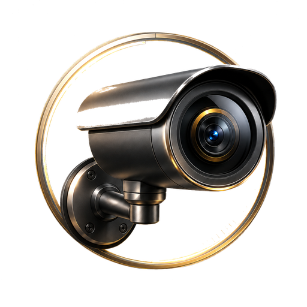

# Foxtail Cameras

[](https://github.com/CDeSanto84/foxtail-cameras/actions/workflows/checks.yml)

**A desktop cockpit for local cameras and Home Assistant.**

A Python/Tkinter dashboard for checking camera-service reachability and opening
camera playback, Blink/Alexa, and Home Assistant from one place. The interface
uses Foxtail's dark surfaces, gold accents, rounded panels, and custom artwork.

## What works

- A home overview and dedicated camera cards.
- Background TCP checks for RTSP (554), the Reolink service (9000), ONVIF's
  configured service port (8000), and Home Assistant.
- Host reachability checks for a Blink sync module and the home server.
- Quick/substream and full/main-stream handoff to the local camera viewer.
- Home Assistant and Alexa browser launch actions.

**Status:** v0.5 integration application, developed for a Debian Linux desktop.
The public source moves household addresses into private configuration. It does
not ship camera credentials, recordings, snapshots, or a household inventory.
Devices and Automations screens are placeholders; they are not complete control
interfaces. The installed private app is separate from this publication copy.

## Run locally

Requires Python 3.10+, Tkinter, Pillow, and a graphical Linux session. On
Debian-based systems, install the system `python3-tk` package and `ping`
(`iputils-ping`). Chrome or Chromium is used for browser app windows.

```bash
python3 -m venv .venv
. .venv/bin/activate
pip install -r requirements.txt
mkdir -p ~/.config/foxtail-cameras
cp config.example.json ~/.config/foxtail-cameras/config.json
chmod 600 ~/.config/foxtail-cameras/config.json
# Edit that private file with your own device hosts.
python app.py
```

A fresh clone has no device addresses and makes no device probes until configured.
Set `FOXTAIL_CAMERAS_CONFIG` to use a different private configuration file. The
configuration accepts IPv4 addresses or DNS hostnames, an integer Home Assistant
port, and an absolute viewer-helper path. Do not put URLs or passwords in host
fields.

## Camera playback boundary

`viewer_helper` points to an executable you control, defaulting to
`~/.local/bin/foxtail-reolink-view`. It receives one argument, `sub` or `main`, and
owns the authenticated connection to your camera and local media player. The
existing private helper is intentionally not distributed. Without a helper,
the dashboard reports that playback integration is missing; status checks and
browser actions remain available.

Blink/Alexa opens the provider's website; this project does not promise that a
particular camera or account supports browser live view. Home Assistant sign-in
remains in its normal browser session.

## Checks

```bash
python3 -m unittest -v test_configuration.py
python3 -m py_compile app.py configuration.py
```

Configuration checks cover fresh-clone privacy, explicit loading, invalid ports,
unknown fields, URL/command-argument rejection, and alternate configuration paths.
No real cameras are contacted by these tests. TCP reachability is not proof of
an authenticated stream, device health, or a secure transport. Playback and
hardware behavior depend on your own devices and helper.
